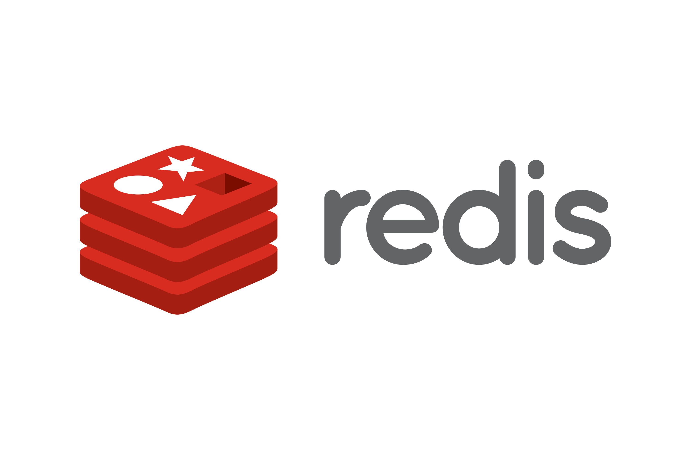

# Building my own Redis



This project is a Java-based experiment in building a Redis-like in-memory database from the ground up. The goal is to explore how Redis works internally: networking, command parsing, data structures, persistence, and performance tuning.

## Why build this?

Redis is a remarkable system: fast, simple, and surprisingly deep. Re-implementing key parts of it in Java helps understand:

- RESP wire protocol
- in-memory key/value storage
- commands like SET, GET, DEL, EXISTS, and INCR
- expiration and eviction policies
- persistence strategies
- concurrency and event loop design

## Project goals

- Build a simple Redis-compatible server in Java
- Support common string and key operations
- Learn how command parsing and request handling work
- Explore efficient data structures for caching and storage
- Tune the implementation for speed and clarity

## Getting started

```bash
mvn test
```

This project is intended as a learning and experimentation repo, so expect the implementation to evolve over time as more Redis concepts are added.

## Roadmap

- Basic TCP server and RESP parsing
- Core key/value commands
- Expiration and TTL support
- Persistence and snapshotting
- Optional client compatibility checks

## Notes

The project name is `redix`, a playful nod to Redis-inspired learning. The icon in this README is a simple Redis-style logo to represent the learning journey.
